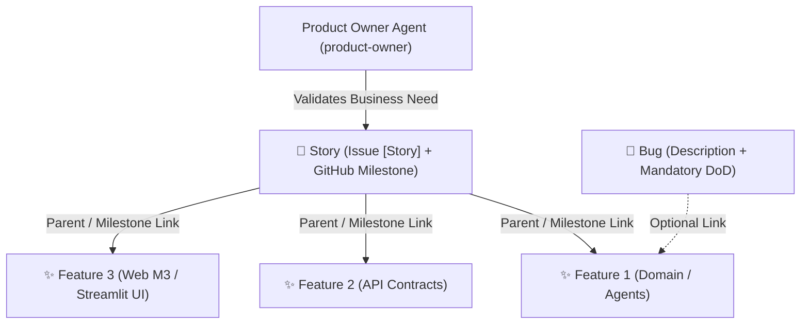

# GitHub Issue Architect Skill (`github-issue-architect`)

This skill defines the workflow, templates, taxonomy, and validation rules for drafting, auditing, and refactoring GitHub issues and milestones in **DataSyntis / Oncoflow**.

All GitHub issues, milestones, and templates MUST be written in **100% English** and respect the Ubiquitous Language defined in [ubiquitous-language-english/SKILL.md](file:///home/guillaume/git/oncoflow/.agents/skills/ubiquitous-language-english/SKILL.md) (`PatientMDTForm`, `PatientRecord`).

---

## 1. Issue Hierarchy & Three Ticket Types

DataSyntis enforces a strict 2-level hierarchy separating **Business What/Why (Story)** from **Technical/Functional How (Feature)**, alongside a strict **Bug** format:

### A. 🎯 Story (`type:story` + GitHub Milestone)
- **Template**: [`.github/ISSUE_TEMPLATE/01_story.yml`](file:///home/guillaume/git/oncoflow/.github/ISSUE_TEMPLATE/01_story.yml)
- **Title Prefix**: `[Story] <Clear Business Title>`
- **Golden Rule**: **MUST ONLY contain the business description of the need.**
  - **Strictly Forbidden**: Python/TypeScript code blocks, file paths (`application/src/...`, `web/src/...`), database collection names, REST route signatures, or implementation task lists.
  - **Mandatory Content**:
    1. **Clinical Domain** (`domain:oncology`, `domain:sma`, or `domain:cross-domain`)
    2. **Primary Hospital Persona** (`persona:physician`, `persona:secretary`)
    3. **DataSyntis Product Promise** (1. Documentary Exhaustiveness, 2. Guideline Compliance, or 3. Operational Fluidity)
    4. **Business Need & Clinical Problem** (concise user story: *As a... When... I face... I need... so that...*)
    5. **Business Rules & Expected Outcome** (numbered functional rules `R1..Rn`, non-prescriptive medico-legal positioning, human-in-the-loop sovereignty)
    6. **Product Owner Validation Checklist** (validated with `product-owner` and `doctor` if clinical rules apply)
- **GitHub Milestone**: Every validated Story corresponds to a GitHub **Milestone** with the same title so child Features can be tracked via milestone progress (`%`).

### B. ✨ Feature (`type:feature`)
- **Template**: [`.github/ISSUE_TEMPLATE/02_feature.yml`](file:///home/guillaume/git/oncoflow/.github/ISSUE_TEMPLATE/02_feature.yml)
- **Title Prefix**: `[Feature] <Concise Actionable Title>`
- **Golden Rule**: **MUST be linked to a parent Story** (`Parent Story: #XX` + assigned to the Story's GitHub Milestone) and be **immediately actionable by both a developer and an AI coding agent**.
- **Mandatory Content**:
  1. **Parent Story & Dependencies**: Explicit link (`Parent Story: #XX · Depends on: #YY`).
  2. **Clinical Domain & Architectural Scope**: `domain:*` + `scope:*` (`scope:domain`, `scope:agents-rag`, `scope:api`, `scope:ui-web`, `scope:ui-streamlit`, `scope:infra`).
  3. **Objective**: 1–3 concise sentences stating the exact goal.
  4. **Description & Technical Specifications**: Expected behavior, impacted Hexagonal/DDD layers, invariants (`manual_edits` preservation, 100% local execution, `PatientMDTForm` ubiquitous language).
  5. **Task List (Optional but recommended)**: Ordered TDD steps (`RED -> GREEN -> REFACTOR`).
  6. **Definition of Done (DoD) — Mandatory**: Verifiable, binary acceptance criteria + quality gates (`ruff`, `pytest`, `vitest`/`playwright`, `prek`).
  7. **Ticket Completeness Status**: Explicitly evaluates whether the ticket is `status:ready` or `status:to-complete`.

### C. 🐛 Bug (`type:bug`)
- **Template**: [`.github/ISSUE_TEMPLATE/03_bug.yml`](file:///home/guillaume/git/oncoflow/.github/ISSUE_TEMPLATE/03_bug.yml)
- **Title Prefix**: `[Bug] <Concise Defect Summary>`
- **Golden Rule**: **Mandatory Description + Mandatory Definition of Done (DoD)**, with zero real patient PII/PHI.
- **Mandatory Content**:
  1. **Severity & Impact** (Critical / Major / Moderate / Minor)
  2. **Impacted Domain & Scope** (`domain:*`, `scope:*`)
  3. **Bug Description (Mandatory)**: Actual Behavior, Expected Behavior, Steps to Reproduce, Technical Context.
  4. **Definition of Done (DoD) — Mandatory**: Failing non-regression test (`RED -> GREEN`), root cause fix respecting DDD/Hexagonal boundaries, and all CI gates green.

---

## 2. Completeness & Triage Rules (`status:to-complete` vs `status:ready`)

A ticket **MUST** be labeled `status:to-complete` (and NEVER `status:ready`) if ANY of the following conditions is true:
1. **Unresolved Questions**: The issue contains open business or clinical questions (`❓`, `🩺`, `Open Questions`, `TBD`). Also add `status:needs-po-validation`.
2. **Missing Parent Story (for Features)**: A Feature does not reference a parent Story (`#XX`) or Milestone.
3. **Incomplete DoD**: The Definition of Done is missing, vague, or still contains `[TBD]` placeholders.
4. **Polluted Story**: A Story contains technical code blocks or file paths that should be extracted into child Feature issues.

Only when all open questions are resolved, the parent Story is linked, and the DoD is 100% verifiable does the ticket transition to `status:ready`.

---

## 3. Logical Label Taxonomy (`.github/labels.yml`)

Always apply labels across 4 orthogonal dimensions (defined in [`.github/labels.yml`](file:///home/guillaume/git/oncoflow/.github/labels.yml)):
1. **Type (1 required)**: `type:story`, `type:feature`, `type:bug`
2. **Status (1 required)**: `status:to-complete`, `status:needs-po-validation`, `status:ready`, `status:blocked`
3. **Domain (1+ required)**: `domain:oncology`, `domain:sma`, `domain:cross-domain`
4. **Scope (1+ for Features/Bugs)**: `scope:domain`, `scope:agents-rag`, `scope:api`, `scope:ui-web`, `scope:ui-streamlit`, `scope:infra`
5. **Persona (optional, recommended for Stories)**: `persona:physician`, `persona:secretary`

---

## 4. Operational Workflow for Drafting or Refactoring Tickets

When asked to create, audit, or rewrite an issue:
1. **Step 1 — Classify**: Determine whether the request is a **Story** (business need), a **Feature** (implementation increment), or a **Bug** (defect). If an issue mixes business vision and deep code specs (like legacy Epic/Lot tickets), split the business need into a `[Story]` and the technical increments into linked `[Feature]` tickets.
2. **Step 2 — Consult Domain Experts**:
   - For a **Story**: Validate the business need, hospital personas, and medico-legal wording against [product-owner/SKILL.md](file:///home/guillaume/git/oncoflow/.agents/skills/product-owner/SKILL.md) (or invoke the `product-owner` subagent).
   - For a **Feature** or **Bug**: Align architectural boundaries and test requirements with [ddd-tdd-architect/SKILL.md](file:///home/guillaume/git/oncoflow/.agents/skills/ddd-tdd-architect/SKILL.md) and [ubiquitous-language-english/SKILL.md](file:///home/guillaume/git/oncoflow/.agents/skills/ubiquitous-language-english/SKILL.md).
3. **Step 3 — Audit Completeness**:
   - Check every item against the completeness rules in Section 2.
   - Assign the exact label set (`type:*`, `status:*`, `domain:*`, `scope:*`, `persona:*`).
4. **Step 4 — Output Clean English Markdown**:
   - Produce concise, structured English Markdown matching the sections of `01_story.yml`, `02_feature.yml`, or `03_bug.yml`.
