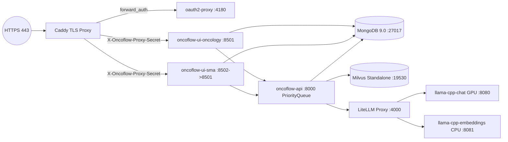

# DataSyntis SRE & DevOps Specialist Skill (`sre-devops-expert`)

Activate this skill whenever designing, auditing, troubleshooting, or optimizing container images, Docker Compose stacks, reverse proxies, SSO authentication, GPU/VRAM inference servers, database operations, observability, or CI/CD pipelines across the repository.

---

## 1. Production Topology & Multi-Domain Architecture

The production stack is defined in [`dist/docker/compose/docker-compose.prod.yml`](../../../dist/docker/compose/docker-compose.prod.yml) and orchestrates:



### Key Architectural Invariants
1. **Multi-Domain Isolation with Shared Queue Worker**:
   - `oncoflow-ui-oncology` (`APP_DOMAIN=oncology`) and `oncoflow-ui-sma` (`APP_DOMAIN=sma`) run as separate stateless Streamlit containers mounting domain-specific document volumes (`/data/meddatasyntis/oncologic` and `/data/meddatasyntis/sma`).
   - `oncoflow-api` (`uvicorn app-api:app --port 8000`) mounts both domain directories and hosts the centralized `PriorityQueue` worker so GPU LLM inference is strictly serialized across domains without VRAM contention.
2. **Loopback-Only Host Port Exposure**:
   - Only `caddy` binds to `0.0.0.0:80` and `0.0.0.0:443` (TCP/UDP).
   - All internal services (`mongod`, `llama-cpp-chat`, `llama-cpp-embeddings`, `litellm`, `oncoflow-ui-oncology`, `oncoflow-ui-sma`, `oncoflow-api`, `oauth2-proxy`) MUST bind host ports strictly to `127.0.0.1:<port>:<container_port>`.

---

## 2. Container Security & Hardening (`dist/docker/Dockerfile` & Compose)

1. **Non-Root Execution & Capability Dropping**:
   - [`dist/docker/Dockerfile`](../../../dist/docker/Dockerfile) runs on `python:3.14-slim` as non-root `appuser` (`UID=1002`, `GID=1002`) with `UV_PYTHON_DOWNLOADS=never` and `uv sync --frozen --no-dev`.
   - In `docker-compose.prod.yml`, `x-ui-common` enforces:
     - `userns_mode: "keep-id"`
     - `cap_drop: ["ALL"]`
2. **Fail-Fast Secret Enforcement**:
   - Never provide weak defaults for production secrets in `docker-compose.prod.yml`. Always use mandatory variable expansion:
     - `${LITELLM_MASTER_KEY:?LITELLM_MASTER_KEY must be set in .env.prod}`
     - `${APP_API_TOKEN:?APP_API_TOKEN must be set in .env.prod}`
     - `${APP_PROXY_SECRET:?APP_PROXY_SECRET must be set in .env.prod}`
   - In `litellm-config.prod.yaml` and `litellm` env, always enforce `LITELLM_DANGEROUSLY_PERMIT_WEAK_OR_UNSET_MASTER_KEY: "false"`.
3. **Zero-Trust Caddy + OAuth2 Proxy Ingress (`dist/docker/compose/Caddyfile`)**:
   - Before calling `import oauth_forward`, Caddy MUST strip any client-forged identity headers:
     ```caddyfile
     request_header -X-Auth-Request-User
     request_header -X-Auth-Request-Email
     request_header -X-Auth-Request-Preferred-Username
     request_header -X-Forwarded-User
     request_header -X-Forwarded-Email
     request_header -X-Forwarded-Preferred-Username
     ```
   - After `forward_auth` succeeds, Caddy injects `header_up X-Oncoflow-Proxy-Secret {$APP_PROXY_SECRET}`, which `app-ui.py` verifies using `hmac.compare_digest()`.

---

## 3. GPU / VRAM Capacity Engineering & Local LLM Serving

1. **24 GB VRAM Budget (NVIDIA L4 Profile)**:
   - **Reasoning Server (`llama-cpp-chat`)**:
     - Runs `Ornith-1.5-35B-A3B-IQ4_XS.gguf` (~19.3 GB weights) on GPU (`-ngl 99`, `--flash-attn on`).
     - Quantizes KV cache (`--cache-type-k q4_0 --cache-type-v q4_0`) to fit a `64000` context window within ~1.5–2 GB VRAM.
     - Caps reasoning loops via `--reasoning-format deepseek --reasoning-budget 6144` to prevent runaway thinking tokens from exhausting context or hanging jobs.
     - Strips CUDA forward-compat libraries (`rm -rf /usr/local/cuda*/compat && ldconfig`) in the entrypoint when host drivers are newer than the container's compat package.
   - **Embeddings Server (`llama-cpp-embeddings`)**:
     - Runs `bge-m3` strictly on CPU (`-ngl 0`, `-c 8192`, `-b 8192`, `-ub 8192`) so embedding requests during RAG retrieval never compete with the main LLM for GPU VRAM.
   - **LiteLLM Unified Gateway (`litellm-config.prod.yaml`)**:
     - Exposes `openai/agents` (`-> http://llama-cpp-chat:8080/v1`) and `openai/embeddings` (`-> http://llama-cpp-embeddings:8080/v1`) with `drop_params: true`.
2. **Cloud Run GPU Benchmarking (`dist/gcloud_test/`)**:
   - Contains declarative Cloud Run GPU service manifests (`cloud-run-service-*.yaml`) and GCS model sync utilities (`dist/gcloud_test/gcs/`) for testing models on L4 GPUs. Never send real patient data to remote test endpoints.

---

## 4. Database Reliability, Observability & Log Management

1. **MongoDB (`oncoflow-mongod`)**:
   - Runs `mongodb/mongodb-community-server:9.0-ubuntu2204` with `oom_score_adj: 200`, `GLIBC_TUNABLES: glibc.pthread.rseq=1`, and a `mongosh` ping healthcheck (`interval: 10s`, `retries: 5`).
   - Downstream services (`oncoflow-ui-*`, `oncoflow-api`) must wait on `mongod: condition: service_healthy`.
2. **Milvus Standalone (`dist/docker/compose/milvus-standalone-docker-compose.yml`)**:
   - Orchestrates `milvus-etcd`, `milvus-minio`, and `milvus-standalone` (`:19530` gRPC, `:9091` healthcheck) on the `milvus` bridge network.
3. **Structured Logging & Rotation**:
   - Production containers log in structured JSON (`APP_LOG_TYPE: json`) to `/var/log/meddatasyntis/meddatasyntis-{oncology,sma,api}.log` with internal rotation (`APP_LOG_MAX_BYTES: 10485760`, `APP_LOG_BACKUP_COUNT: 5`).
   - Docker daemon logging uses `json-file` with `max-size: 20m`, `max-file: 5`, `compress: "true"`.
   - Host logrotate policy is maintained in [`dist/logrotate/meddatasyntis`](../../../dist/logrotate/meddatasyntis).

---

## 5. CI/CD & DevSecOps Pipeline (`.github/workflows/ci.yml`)

Every change to `application/`, `dist/docker/`, or `.github/workflows/ci.yml` must satisfy the CI pipeline gates:
1. **Dependency & Lockfile Integrity**:
   - Always use `uv sync --frozen` against `application/uv.lock` (never unpinned `pip install`).
2. **Static Analysis & Formatting**:
   - `uv run --frozen ruff format . --check`
   - `uv run --frozen ruff check .`
   - `uv run --frozen pyrefly check src`
3. **Automated Tests & Coverage**:
   - `PYTHONPATH=. uv run --frozen pytest --timeout=300 --cov=src --cov-report=xml:coverage.xml tests/ src/`
4. **Vulnerability & Secret Scanning (Trivy)**:
   - `aquasecurity/trivy-action` scans the filesystem for `CRITICAL,HIGH` CVEs and leaked secrets (`scanners: "vuln,secret"`, `exit-code: "1"`), respecting `.trivyignore`.
5. **Container Build Verification**:
   - `docker build -f dist/docker/Dockerfile` must succeed cleanly on every PR and push.
