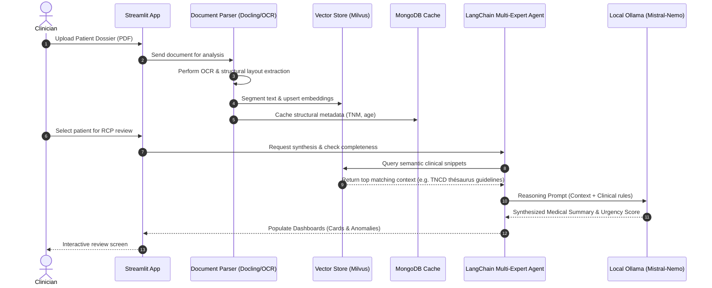

# 💻 MedDataSyntis — Technical Reference Guide

This document provides a comprehensive technical overview of the **MedDataSyntis** platform. It describes the clean onion architecture, infrastructure dependencies, data flows, and full environment variable configurations.

---

## 🏗️ Clean Onion & Hexagonal Architecture

MedDataSyntis separates its presentation and backend layers cleanly across two decoupled workspaces:
1. **`web/` — Node.js 24 + Fastify 5 Material Design 3 Web UI (Hexagonal BFF)**: Server-rendered clinical web interface communicating exclusively with the Python FastAPI backend over HTTP/SSE.
2. **`application/` — Python `>=3.13` FastAPI & Multi-Agent RAG Backend (Clean Onion Architecture)**: Keeps domain rules (`domain/`) independent of databases (`infrastructure/`), orchestration (`application/`), and user interfaces (`routers/` & legacy `ui/`).

```
   ┌─────────────────────────────────────────────────────────────────────┐
   │  web/ (Node.js 24 + Fastify 5 + TypeScript — Material Design 3 UI)  │
   │  • src/domain/         (Triage rules, i18n, clinical catalog)       │
   │  • src/application/    (Worklist, Dossier, Agenda, Guidelines UCs)  │
   │  • src/infrastructure/ (HttpOncoflowApiAdapter & InMemoryFake)      │
   │  • src/ui/             (Fastify BFF routes, M3 SSR templates, CSS)  │
   └──────────────────────────────────┬──────────────────────────────────┘
                                      │ REST & SSE (/api/v1/*)
                                      ▼
   ┌─────────────────────────────────────────────────────────────────────┐
   │  application/ (Python >= 3.13 — FastAPI app-api.py & Streamlit)     │
   │  • src/routers/        (FastAPI /api/v1/rcp, /mdt/agenda, /queue)   │
   │  • src/application/    (Agents, Use cases, PriorityQueue, RAG)      │
   │  • src/domain/         (Entities: Patient, PatientMDTForm, Agenda)  │
   │  • src/infrastructure/ (Milvus, MongoDB, Docling/MuPDF/OCR Parsers) │
   └─────────────────────────────────────────────────────────────────────┘
```

### Module breakdown under `web/src/` (Material Design 3 Web UI):
* **`domain/`**: Pure TypeScript clinical domain logic (`triage.ts` for urgency/completeness/orientation badges and deltas, `catalog.ts` for Oncology & SMA section metadata and quick prompts, `i18n.ts`, `types.ts`).
* **`application/`**:
  * **`ports/oncoflow-api.port.ts`**: Hexagonal port contract for all backend operations.
  * **`use-cases/`**: `worklist.use-case.ts`, `patient-dossier.use-case.ts`, `guidelines.use-case.ts`, `ingest.use-case.ts`, `feedback.use-case.ts`, `queue-admin.use-case.ts`.
* **`infrastructure/api/`**:
  * **`http-oncoflow-api.adapter.ts`**: Production HTTP/REST adapter targeting FastAPI (`/api/v1/*`).
  * **`in-memory-oncoflow-api.fake.ts`**: Deterministic clinical fixture adapter (Oncology & SMA) used for offline development (`APP_DEV_MODE=true`), Vitest integration tests, and Playwright E2E tests.
* **`ui/`**:
  * **`server.ts`**: Fastify 5 BFF server with strict `Content-Security-Policy` (`default-src 'self'`), Zero-Trust `X-Oncoflow-Proxy-Secret` verification (`oauth_proxy` mode), host-based clinical domain resolution (`oncologic.*` -> `oncology`, `sma.*` -> `sma` without redundant `?domain=` query string), and SSE proxy streaming (`/events/queue`).
  * **`templates.ts` & `components/ai-chat.component.ts`**: Material Design 3 SSR HTML views (`Worklist`, `Ordre du jour RCP /agenda`, `Dossier patient longitudinal`, `Co-Pilot IA Side Sheet`, `Référentiels`, `Experts IA`, `Supervision File GPU`, `Signalements`).
* **`public/`**: Zero-CDN self-hosted CSS tokens (`public/css/tokens.css`, `public/css/components.css`), progressive enhancement client script (`public/js/app.js`), and 58-icon M3 SVG sprite (`public/img/icons.svg`).

### Module breakdown under `application/src/`:
* **`domain/`**: Contains the core domain schemas (`patient.py` with `Patient(BaseModel)`, `mdt_agenda.py` for RCP session scheduling & expert grouping, `common/common_ressources.py`, `patient_mdt_form.py`, `agents.py`), validation boundaries, and abstract interface contracts.
* **`application/`**:
  * **`patient.py`**: Patient business logic (deterministic `patient_id` generation from normalized `last_name + first_name + date_birth`, automatic/manual patient association during RCP upload, card metrics extraction, latest analyzed RCP selection, dossier resolution, and chronological AI history formatting via `format_patient_ai_history`).
  * **`use_cases/mdt_agenda_management.py`**: Orchestrates the next RCP/MDT session agenda (`urgency_first` vs `expert_grouping` sort strategies, quorum computation, specialist passage windows, pin/move overrides, and direct session onboarding).
  * **`agent/`**: The core multi-expert LangChain agent coordinator (`agent.py`) and context-separated tools (`tools.py` with `Context` for single-RCP extraction/chat using `get_mtd_markdown`, and `PatientContext` for full-dossier patient chat using `get_patient_mtds_markdown` and `get_patient_ai_history`).
  * **`reader.py`**: The RAG (Retrieval-Augmented Generation) ingestion and matching pipeline.
  * **`config.py`**: Reads environmental configurations and exposes them statically via the `AppConfig` class.
* **`infrastructure/`**:
  * **`vectorial/`**: Database wrappers for Milvus and Chroma vector databases.
  * **`documents/mongodb.py`**: Repositories handling MongoDB integrations for `patients`, `rcp_info`, `mdt_agendas`, and `document_cache`.
  * **`parsers/`**: Ingestion layer leveraging **Docling**, **MuPDF**, **OpenParse**, or **Ollama OCR** for reading patient folders.
* **`routers/`**: FastAPI v1 REST & SSE routers (`rcp.py`, `agenda.py`, `agents.py`, `resources.py`, `queue.py`, `bug_reports.py`).
* **`ui/`**: Legacy Streamlit pages (`patient_mdt/` cards, unified patient dossier view, batch upload, and active agent visualizations).

---

## 🗄️ Database & Storage Layer

MedDataSyntis employs dual storage paradigms to ensure ultra-low latency and scalable local lookups:

### 1. Vector Search Engines (Similarity Store)
* **Milvus (Production Default)**: Run as a local docker container (`milvus-standalone`). Used to index dense embeddings of patient records and TNCD clinical thésaurus guidelines for similarity semantic queries. Uses `pymilvus==2.6.14` and `langchain-milvus==0.3.3`.
* **Chroma (Development Alternative)**: Running in either a local persistent client or a lightweight http server. Convenient for isolated local development without full docker footprints.

### 2. Relational / Document Store
* **MongoDB**: Standard persistent storage database. It maintains:
  * **`patients` collection**: Patient dossiers (`patient_id`, `first_name`, `last_name`, `born_name`, `date_birth`, `gender`, `files`, `updated_at`).
  * **`rcp_info` collection**: Extracted structural metadata of each RCP file (`file`, `patient_id`, `ui_date`, `PatientAdministrative`, `ExpertAnswer`, `MTDCompleted`, etc.).
  * **`document_cache` collection**: System cache of parsed Markdown documents to prevent redundant OCR/parsing.

---

## 🤖 Local AI & Reasoning Engine

All machine learning models run strictly inside the local network boundary via **Ollama**.

* **Reasoning Model**: `mistral-nemo` (12B parameters, highly accurate on French medical terminology) or `llama3.1` variations.
* **OCR/Vision Model**: `granite3.2-vision` (used by Ollama OCR to analyze complex scanned paper diagrams or handwritten hospital documents).
* **Embeddings**: `nomic-embed-text` or `all-MiniLM-L6-v2` (for converting text chunks into 384/768-dimensional float vectors).

---

## ⚙️ Comprehensive Environment Variables

MedDataSyntis is highly customizable through environment variables parsed transparently by `environ-config` under `AppConfig` (prefixed with `APP_`).

| Variable Name | Type | Default Value | Description |
| :--- | :--- | :--- | :--- |
| **`APP_LOGS_LEVEL`** | `str` | `INFO` | Standard application logging level (`DEBUG`, `INFO`, `WARNING`, `ERROR`). |
| **`APP_LOGS_TYPE`** | `str` | `text` | Logging structure format (`text` or `json`). |
| **`APP_LOGS_LANGCHAINDEBUG`** | `bool`| `False` | Toggle to enable internal LangChain verbose debugging output. |
| **`APP_LLM_TYPE`** | `str` | `Ollama` | LLM service engine style. |
| **`APP_LLM_URL`** | `str` | `http://127.0.0.1`| Base endpoint of the local inference server. |
| **`APP_LLM_PORT`** | `str` | `11434` | Inference server port. |
| **`APP_LLM_MODELS`** | `str` | `gemma4:e4b` | Model identifier for generation/reasoning. |
| **`APP_LLM_OCRMODELS`** | `str` | `granite3.2-vision` | Model identifier for vision-based OCR extraction. |
| **`APP_LLM_TEMP`** | `float`| `1.0` | Sampling temperature for the model. |
| **`APP_LLM_EMBEDDINGS`**| `str` | `embeddinggemma` | Vector embedding model name. |
| **`APP_DBVEC_TYPE`** | `str` | `milvus` | Production Vector store backend (`milvus` or `chroma`). |
| **`APP_DBVEC_COLLECTION`**| `str` | `oncoflowDocs` | Base collection name for vector indices. |
| **`APP_MILVUS_TOKEN`** | `str` | `root:Milvus` | Authentication credentials for Milvus DB. |
| **`APP_MILVUS_DATABASE`**| `str` | `oncowflow` | Milvus target database name. |
| **`APP_MILVUS_PORT`** | `str` | `19530` | Milvus service port. |
| **`APP_MILVUS_HOST`** | `str` | `localhost` | Hostaddress of Milvus standalone server. |
| **`APP_CHOMA_CLIENT`** | `str` | `HttpClient` | Chroma database connector class (`HttpClient` or `PersistentClient`). |
| **`APP_CHOMA_HOST`** | `str` | `localhost` | Chroma HTTP host address. |
| **`APP_CHOMA_PORT`** | `str` | `8000` | Chroma HTTP service port. |
| **`APP_MONGODB_USER`** | `str` | `root` | Root username for MongoDB service. |
| **`APP_MONGODB_PASSWORD`**| `str` | `root` | Root password for MongoDB service. |
| **`APP_MONGODB_HOST`** | `str` | `127.0.0.1` | Hostaddress of MongoDB server. |
| **`APP_MONGODB_PORT`** | `str` | `27017` | Service port for MongoDB. |
| **`APP_MONGODB_DATABASE`**| `str` | `Oncoflow` | Relational/Document metadata database name. |
| **`APP_MONGODB_VECTORDATABASE`**| `str`| `OncoflowVector`| Alternate vector store database name if MongoDB is configured as vector store. |
| **`APP_RCP_PATH`** | `path` | `ressources/PatientMDTOncologicForm` | Local directory containing patient dossier PDF documents. |
| **`APP_RCP_ADDITIONAL_PATH`**| `path`| `ressources/TNCD` | Local directory containing official TNCD clinical thésaurus guidelines. |
| **`APP_RCP_DOC_TYPE`** | `str` | `docling` | Parsing engine standard used for layout extraction (`docling`, `pypdf`, `pymupdf`). |
| **`APP_RCP_CHUNK_SIZE`** | `int` | `1000` | Length boundary of text chunks during vector ingestion. |
| **`APP_RCP_CHUNK_OVERLAP`**| `int` | `150` | Length of consecutive text overlap between sliding chunks. |
| **`APP_RCP_MANUAL_QUERY`**| `bool`| `False` | Run CLI interactive prompt loop instead of Streamlit GUI. |
| **`APP_RCP_DISPLAY_TYPE`**| `str` | `mongodb` | Underlying display mechanism style. |

### Environment Variables for the Material Design 3 Web UI (`web/`):

| Variable Name | Type | Default Value | Description |
| :--- | :--- | :--- | :--- |
| **`PORT_WEB`** | `int` | `3000` | Listening TCP port for the Fastify BFF web server. |
| **`HOST_WEB`** | `str` | `0.0.0.0` | Bind address for the Fastify server (`127.0.0.1` in local dev/E2E). |
| **`APP_API_URL`** | `str` | `http://127.0.0.1:8000` | Upstream Python FastAPI base URL. |
| **`APP_API_TOKEN`** | `str` | `""` | Shared Bearer token sent to the FastAPI backend (`Authorization: Bearer ...`). |
| **`APP_DOMAIN`** | `str` | `oncology` | Default clinical domain for the instance (`oncology` or `sma`). |
| **`APP_ALLOWED_DOMAINS`** | `str` | `oncology,sma` | Comma-separated list of enabled clinical domains. |
| **`APP_AUTH_MODE`** | `str` | `none` | Authentication mode (`oauth_proxy` in production behind Caddy + OAuth2-Proxy, `none` in local dev). |
| **`APP_PROXY_SECRET`** | `str` | `""` | Shared secret verified against the `X-Oncoflow-Proxy-Secret` header when `APP_AUTH_MODE=oauth_proxy`. |
| **`APP_ADMIN_USERS`** | `str` | `admin` | Comma-separated list of usernames/emails granted GPU queue administration rights. |
| **`APP_DEV_MODE`** | `bool` | `true` | Enables automatic fallback to `InMemoryOncoflowApiFake` when FastAPI is unreachable in local dev (forced to `false` in production). |

---

## ⚡ Execution Ingestion Flow (RAG Sequence)

The diagram below details how patient medical records are parsed, embedded, and queried in conformity with French oncology guidelines.



---

## 🛠️ Developer Warnings & Optimizations

* **Warning Suppressions**: Real-time hospital displays run without console logs pollution. The core `app-ui.py` automatically handles the filtering of standard deprecation logs:
  - Suppresses Hugging Face Transformers module path imports warnings.
  - Suppresses PyMilvus ORM-style warning hooks (`Index.to_dict is deprecated`).
  - Suppresses streamlit-pdf-viewer experimental annotation warnings.
* **Environment variables checks**: Run `uv run python -c "import json; from src.application.config import AppConfig; print(json.dumps(AppConfig.model_json_schema(), indent=2))"` inside the `application/` folder to check validation settings of all environment variables currently loaded on your host machine.
